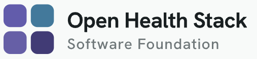

```js
import {bigNumber, card, groupedBars, monthLine, stackedMonths, rankedBars} from "./components/charts.js";

const kpis = await FileAttachment("data/kpis.csv").csv({typed: true});
const genderAge = await FileAttachment("data/gender_age.csv").csv({typed: true});
const visits = await FileAttachment("data/visits_month.csv").csv({typed: true});
const enrolments = await FileAttachment("data/enrolments_month.csv").csv({typed: true});
const tables = await FileAttachment("data/tables.csv").csv({typed: true});
const built = (await FileAttachment("data/built.csv").csv())[0].built;
const empty = kpis.every((k) => Number(k.value) === 0);
const accents = ["#625cab", "#43799b", "#413b75", "#6f7779"];
```



<div class="top">
  <div>
    <h1>Community health overview</h1>
    <p class="sub">Synthetic data, read from the flat tables FHIR Data Pipes writes to Postgres</p>
  </div>
  <nav class="tabs"><a class="on" href="./">Overview</a><a href="./immunization">Immunization</a></nav>
</div>

<p class="fresh">Built ${built}</p>

${empty ? html`<div class="empty"><strong>No data in the analytics database yet</strong><p>The FHIR server holds the data, but the pipeline has not run. Open the Pipelines tab and click Run Full, or type <code>run-pipeline</code> in the Editor terminal. This page rebuilds by itself when the tables fill.</p></div>` : ""}

<div class="kpis">${kpis.map((k, i) => bigNumber(k.metric, k.value, accents[i % accents.length]))}</div>

<div class="grid grid-cols-2">
  ${card("Patients by age group and gender", "Count of distinct patients", resize((width) => groupedBars(genderAge, {x: "age_group", y: "patients", fill: "gender", order: ["0-4", "5-14", "15-24", "25-49", "50+", "Unknown"], width})))}
  ${card("Visits per month", "Encounters, by the month they started", resize((width) => monthLine(visits, {y: "visits", width})))}
</div>

<div class="grid grid-cols-2">
  ${card("Programme enrolments per month", "A Condition record is an enrolment", resize((width) => stackedMonths(enrolments, {y: "enrolments", z: "programme", width})))}
  ${card("Rows in each flat table", "Watch these grow when you run the pipeline", resize((width) => rankedBars(tables, {label: "resource", value: "rows", width})))}
</div>

<p class="note">Each number is a SQL query in <code>src/data</code>. Change a ViewDefinition, run the pipeline, and the page rebuilds about 30 seconds after the tables change. The Refresh dashboard button does it at once.</p>
